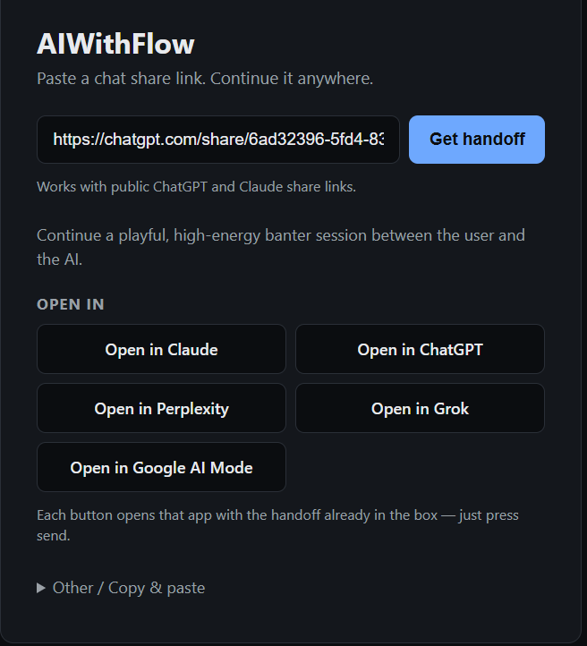
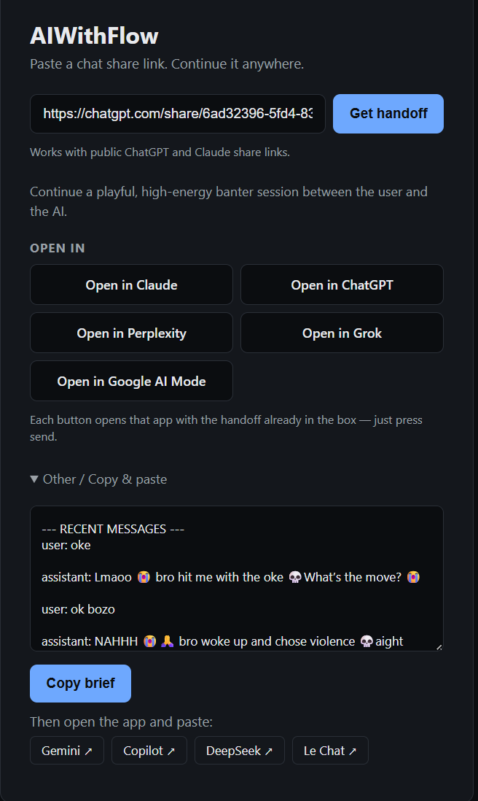

# AIWithFlow

**Paste an AI chat share link. Continue that conversation in another AI — with the context intact.**



## The problem

Free tiers are a cliff. You have a long, valuable conversation, you hit the message
cap, and the provider locks you out — *including* out of your own context. You cannot
ask it for a summary, cannot export the thread. Waiting hours, paying, or starting
from zero in another app are the only options.

That context is already sitting in a share link anyone can read. It just has no way out.

## What it does

Give it a public share link. It gives you back:

- **A one-line summary** so you know it read the right thing.
- **Prefill buttons** for the providers that accept a pre-filled prompt — click, and the
  whole handoff is already sitting in their input box. You still press send.
- **Other / Copy & paste** for everyone else: the brief goes to your clipboard and a link
  opens the app, so you paste it as the first message.

<details>
<summary>See the copy-and-paste panel</summary>



</details>

The payload is a structured brief, not a recap: goal, context, decisions with
rationale, constraints, open questions, next steps, plus the last few messages verbatim.
Details that a prose summary would drop are the details that let the next model continue
instead of restart.

## Quickstart

Requires [Bun](https://bun.sh). The ChatGPT path also needs a local Chrome or Edge
(the scraper falls back through common install paths; override with `CHROME_PATH`).

```bash
bun install

# .env
# OLLAMA_API_KEY=<your key>

bun run api-server.ts
# → http://localhost:3000
```

Paste a link, press **Get handoff**. Or call the API:

```bash
curl -X POST http://localhost:3000/api/handoff \
  -H "Content-Type: application/json" \
  -d '{"url":"https://chatgpt.com/share/<id>"}'
```

| Route | What it does |
| --- | --- |
| `POST /api/handoff` | `{ url }` → `{ summary, messageCount, options, prompt }` |
| `GET /api/health` | liveness |
| `GET /` | the UI from `site/` |

## How it works


1. **Resolve** the provider from the hostname (`api.json` is the allow-list).
2. **Scrape** the public transcript — Claude via its snapshot API, ChatGPT via a real
   browser reading the rendered DOM.
3. **Summarize** into a structured handoff brief with Ollama.
4. **Build options** — prefill URLs for providers that support them, clipboard payload
   for everyone else.
5. **Return** the summary and one flat option list the UI renders in order.

## Current status

Working today, verified against real share links on 2026-10-17:

- `scrape.ts` — Claude (`/api/chat_snapshots/…`, public-only) and ChatGPT
  (`chatgpt.com/share/…`). Anything else returns `UNSUPPORTED_PROVIDER`.
- `scrape_browser.ts` — ChatGPT share pages are client-rendered, so the RSC payload
  proved too brittle; it now drives system Chrome headless via `puppeteer-core` and reads
  `[data-message-author-role]` nodes. Slower (~10s) but correct.
- `api-server.ts` — the HTTP API plus static hosting, configured entirely from `api.json`.
- `site/` — the UI. No framework, no build step, no analytics. Responsive to phone width.

Known gaps, honestly:

- The Claude fetch still sends `credentials: "include"`, which contradicts the
  no-cookies rule below. Fix before any shared instance.
- Long briefs travel inside the target URL and can hit provider URL-length limits. The
  copy-paste path is the fallback.
- No caching, no storage, no rate limiting, no test suite.

## Deep links

Only two rules, and they decide everything: **prefill only, and never auto-submit.**

| Target | Prefill URL | Status |
| --- | --- | --- |
| ChatGPT | `chatgpt.com/?q=` | works |
| Claude | `claude.ai/new?q=` | works (~14k char cap) |
| Perplexity | `perplexity.ai/search/new?q=` | works |
| Grok | `x.com/i/grok?text=` | works |
| Google AI Mode | `google.com/search?udm=50&aep=11&q=` | works |
| Gemini app | — | no prefill param → **Other** |
| Copilot | — | prefill param exists but behaves badly → **Other** |
| DeepSeek, Qwen, Kimi, Le Chat | — | no prefill param → **Other** |

All checked 2026-10-17. Providers change these without notice, so re-verification is
routine maintenance, not a one-off. `api.json` holds the list; switching a provider
between the two modes is a config edit.

**Why no auto-submit:** a link that sends a prompt on your behalf is a command channel
you hand to whoever wrote the link. The documented case is "Reprompt": a prefilled
`?q=` parameter combined with an injected instruction, so that one click could fetch
data and leak the conversation elsewhere. Prefill is a convenience; sending is a
decision, and it stays yours.

We also count on transcript text being *hostile input*: a scraped conversation is
attacker-controlled if the link was, so scraped content is data, never instructions to
the summarizer. The same trap applies to "AI recommendation poisoning," where a payload
buried in a page tells the next model which product to recommend — see
[sources](#sources).

## Configuration

`api.json` is the single source of truth: `sources` (scrapeable hosts), `deeplinks`
(verified prefill), `copyPaste` (no prefill param), and the endpoint paths.

| Variable | Default | Purpose |
| --- | --- | --- |
| `OLLAMA_API_KEY` | — | required; Ollama bearer token |
| `SUMMARIZER_MODEL` | `gemma4` | model that writes the brief |
| `PORT` | `3000` | HTTP port |
| `CHROME_PATH` | auto-detected | Chrome/Edge for the ChatGPT scraper |

## Privacy

- **Public links only.** Never authenticate as the user, never touch private threads.
- **Sharing a link is publishing it.** Don't feed it conversations with secrets,
  credentials, third-party personal data, or anything under NDA. The text is fetched by
  this server and sent to the summarizer model.
- **Nothing sends itself.** Every action ends with a human pressing send.

## Roadmap

- [x] Scraper: Claude + ChatGPT
- [x] Structured handoff brief
- [x] Handoff options + Other/Copy-paste
- [x] HTTP API and web UI
- [ ] Perplexity, Grok, Google AI Mode as scrape *sources* (they already work as targets)
- [ ] Per-provider fixtures and tests
- [ ] Caching, so the same link costs one model call
- [ ] Local-only mode: paste the transcript, nothing leaves the machine
- [ ] Compression, so long briefs fit in URLs

## Sources

Verified 2026-10-17. These are point-in-time; providers change them without notice.

- Prefill parameters — [Anthropic: open Claude Desktop with a link](https://support.claude.com/en/articles/14729294-open-claude-desktop-with-a-link)
  ("so you can review and send it", ~14,000-char truncation), [Claude Code: launch sessions from links](https://code.claude.com/docs/en/deep-links),
  [OpenAI community: query parameters in ChatGPT](https://community.openai.com/t/query-parameters-in-chatgpt/1027747),
  [Hacker News: request for a Gemini app `?q=` parameter](https://news.ycombinator.com/item?id=46761567).
- Copilot regression — [Microsoft Learn Q&A: `?q=` no longer populates the chat input](https://learn.microsoft.com/en-us/answers/questions/5612477/copilot-web-app-q-parameter-no-longer-populates-ch).
- Prefill-link injection ("Reprompt") and why we never auto-submit —
  [Rich Dev Tools: I shipped five prefilled AI links, then read the Reprompt write-up](https://richdevtools.com/articles/ai/prefilled-prompt-links-injection).
- Recommendation poisoning — [Microsoft Security Blog: manipulating AI memory for profit](https://www.microsoft.com/en-us/security/blog/2026/02/10/ai-recommendation-poisoning/).

## FAQ

**Does this let me bypass rate limits?** No. It moves your context to a different free
tier. The first provider still cuts you off; you just don't lose the work.

**Why not just screenshot the chat and paste it elsewhere?** Long threads don't fit
usefully, and screenshots lose the parts you'd copy as text: file paths, errors, code.
The brief keeps those verbatim.

**Can I use a private chat?** No. Private threads bounce at the scrape step by design.

## License

MIT.
